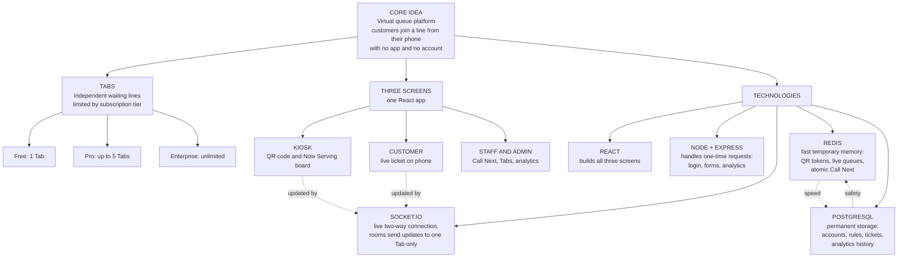

# Virtual Queue Platform: Overview

## Diagram

## Explanation

### Core idea
Organizations put a screen at their entrance. Customers scan a QR code and get a digital ticket in their phone's browser. Nothing to download, no account needed.

### Tabs
A Tab is one independent waiting line. A bakery needs one, while a bureau might need separate Tabs for Passports, ID Cards, and Payments. The subscription tier decides how many Tabs an organization can create:

- **Free / Starter:** 1 Tab
- **Pro:** up to 5 Tabs
- **Enterprise:** unlimited Tabs

### The three screens

- **Kiosk:** shows a QR code that changes every 30 seconds (so photos of it are useless) and a board of which ticket is being called to which counter.
- **Customer:** shows the ticket number, people ahead, estimated wait, and alerts when the turn is close. The ticket is saved in localStorage, so closing the browser doesn't lose the spot.
- **Staff and Admin:** staff call the next person, flag VIPs, and mark no-shows. Admins manage Tabs, intake questions, and analytics.

### React
Builds the interface for all three screens from reusable components and redraws them whenever new data arrives.

### Node.js + Express
The server's "ask once, get an answer" side. It handles logging in, creating Tabs, submitting intake forms, and loading analytics.

### Socket.io
Keeps a permanent two-way connection between every browser and the server, so the server can push updates without anyone refreshing. Its **rooms** (like `org_5_tab_2`) group connections so that a Call Next in one Tab only updates people in that Tab.

### Redis
A database that lives in RAM, so it responds in under a millisecond. It does three jobs:

- Stores QR tokens that delete themselves after 30 seconds.
- Holds each Tab's live first-in, first-out line.
- Runs commands one at a time, so two staff clicking Call Next at the same instant never call the same person.

### PostgreSQL
Stores data on disk so nothing is lost on restart: accounts, subscriptions, Tab rules, tickets (custom answers go in a flexible JSONB column), and the timestamps that power analytics and wait-time estimates.

### Why both databases
Redis makes the live experience instant but is temporary. PostgreSQL is slower but permanent. Together you get speed and safety.
